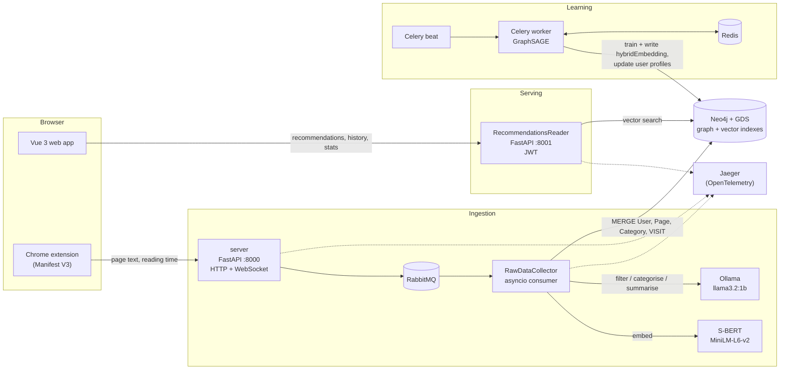
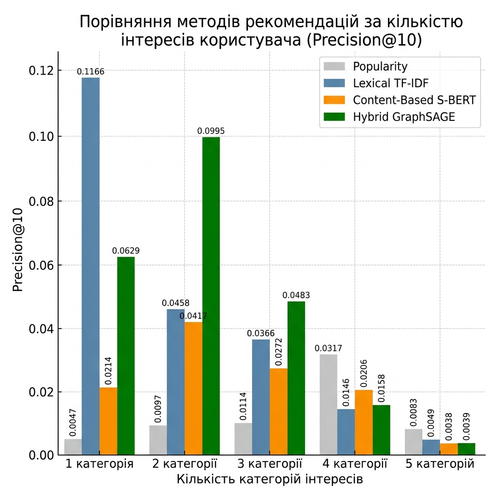

# Tab Insights — personalised web-page recommendations

[](https://github.com/Shemberko/dyplom/actions/workflows/tests.yml)


A Chrome extension collects what you actually read (page text, active reading time, clicks), a set of Python
microservices turns it into a knowledge graph with LLM-generated categories and sentence embeddings, and a
**GraphSAGE** graph neural network learns hybrid (content + behaviour) embeddings that power personalised
recommendations in a Vue web app.

Bachelor's thesis, Lviv Polytechnic National University, Software Engineering, 2026.


## Highlights

- **Event-driven microservices** — FastAPI ingestion gateway → RabbitMQ → async consumer; read API is a separate service.
- **LLM pipeline** — local `llama3.2:1b` via Ollama filters junk pages, assigns categories and writes summaries; S-BERT
  (`all-MiniLM-L6-v2`) builds 384-d embeddings.
- **Graph ML** — pages, users and categories live in Neo4j; a Celery beat job projects the graph and trains/applies
  GraphSAGE (Neo4j GDS) to produce 128-d hybrid embeddings.
- **Hybrid retrieval** — the user profile is a time-decayed, reading-time-weighted average of visited pages; candidates
  come from two Neo4j vector indexes (text + hybrid) and are merged with weights, falling back to trending pages.
- **Offline evaluation** — Precision@k / NDCG@k against Popularity, TF-IDF and pure S-BERT baselines.
- **Production concerns** — JWT auth, OpenTelemetry tracing to Jaeger, retries on broker connection, bounded
  concurrency, 150+ pytest tests with all external systems mocked, CI on GitHub Actions.

## Architecture



| Service | Path | Role |
|---|---|---|
| Ingestion gateway | [`server/`](server) | FastAPI; receives activity from the extension over HTTP/WebSocket, publishes to RabbitMQ |
| Raw data collector | [`microservices/RawDataCollector/`](microservices/RawDataCollector) | Consumes the queue; URL normalisation, LLM filtering & categorisation, embeddings, writes the graph |
| Recommendations builder | [`microservices/RecommendationsBuilder/`](microservices/RecommendationsBuilder) | Celery worker + beat; GraphSAGE training/inference, incremental user-profile updates |
| Recommendations reader | [`microservices/RecommendationsReader/`](microservices/RecommendationsReader) | FastAPI read API: auth, recommendations, history, statistics |
| Web app | [`frontend/`](frontend) | Vue 3 + TypeScript + Pinia + Tailwind |
| Browser extension | [`google_add/`](google_add) | Tracks active tab time, extracts page content, sends it to the gateway |

More diagrams (deployment, sequence, graph schema) are in [`docs/architecture-diagrams.md`](docs/architecture-diagrams.md).

## How recommendations are built

1. **Ingest.** Every new page goes through a cheap rule filter (search results, account pages, errors, empty text)
   and then an LLM check; the LLM picks 1–2 categories (preferring existing ones) and writes a short summary,
   which is embedded with S-BERT.
2. **Graph.** `(:User)-[:VISIT {active_time, source}]->(:Page)-[:IN_CATEGORY]->(:Category)`.
3. **Hybrid embeddings.** Every run the Celery job projects the graph and trains GraphSAGE on it
   (S-BERT vectors as node features, visit weights as edge weights) and writes a 128-d `hybridEmbedding` to every page.
4. **User profile.** Each visit is weighted by reading time, recency and whether it came from a recommendation:

   ```
   w = reading_minutes · exp(−0.05 · days_since_visit) · (2.0 if from recommendation else 1.0)
   profile = normalize( Σ wᵢ · embᵢ / Σ wᵢ )      # with 0.98 decay of the old running sum
   ```

5. **Serve.** The API queries both vector indexes with the user profile, removes already-seen pages, merges and
   re-weights the two candidate lists, and falls back to trending pages for cold-start users.

Formulas and the reasoning behind them: [`docs/algorithms-and-formulas.md`](docs/algorithms-and-formulas.md) (UA).

## Results

Offline evaluation on synthetic users with 1–5 interest categories (hold-out of each user's visits):



- Hybrid GraphSAGE gives the best Precision@10 for users with **2–3 interests** (0.0995 and 0.0483) — about 2× the
  pure content-based S-BERT model, because graph neighbourhoods capture co-visitation, not only text similarity.
- For a single narrow interest plain **TF-IDF wins** (0.1166 vs 0.0629): exact keyword overlap is hard to beat there.
- With 4–5 interests all methods converge towards the popularity baseline — a clear direction for future work
  (per-interest profiles instead of one averaged vector).

Evaluation scripts: [`microservices/RawDataCollector/app/evaluate_recommendation_logic*.py`](microservices/RawDataCollector/app).

## Getting started

**Requirements:** Docker with Compose v2, ~16 GB RAM (Neo4j + LLM + S-BERT), Node.js 18+ for the web app and extension.

```bash
git clone https://github.com/Shemberko/dyplom.git && cd dyplom
cp .env.example .env            # set NEO4J_PASSWORD and JWT_SECRET_KEY
docker compose up --build       # first start downloads the Neo4j GDS plugin and the LLM
```

| URL | What |
|---|---|
| http://localhost:8000/docs | Ingestion gateway (Swagger) |
| http://localhost:8001/docs | Recommendations API (Swagger) |
| http://localhost:7474 | Neo4j Browser |
| http://localhost:15672 | RabbitMQ management (guest / guest) |
| http://localhost:16686 | Jaeger traces |

**Web app**

```bash
cd frontend && npm install && npm run dev      # http://localhost:5173
```

**Browser extension**

```bash
cd google_add && npm install && npm run build
```

Open `chrome://extensions`, enable *Developer mode*, *Load unpacked* → select `google_add/dist`.
Log in from the extension popup and browse as usual; recommendations appear after the first builder run
(every 30 s).

## Tests

Each service has its own pytest suite; Neo4j, RabbitMQ, Redis and Ollama are mocked, so no infrastructure is needed.

```bash
make test                     # all services in Docker
make test-local-reader        # one service locally (also: -server, -rawdata, -builder)
```

CI runs the same suites on every push ([`.github/workflows/tests.yml`](.github/workflows/tests.yml)).

## Tech stack

**Backend:** Python 3.11, FastAPI, Pydantic, asyncio, aio-pika, Celery, Redis, RabbitMQ, python-jose (JWT)
**ML / AI:** Neo4j Graph Data Science (GraphSAGE), sentence-transformers, Ollama (Llama 3.2), scikit-learn, NumPy
**Data:** Neo4j 5 (graph + vector indexes)
**Frontend:** Vue 3, TypeScript, Pinia, Vite, Tailwind CSS, Chrome Extension Manifest V3
**Ops:** Docker Compose, OpenTelemetry + Jaeger, GitHub Actions, pytest

## Project structure

```
.
├── server/                         # ingestion gateway (FastAPI)
├── microservices/
│   ├── RawDataCollector/           # queue consumer, LLM + embeddings
│   ├── RecommendationsBuilder/     # Celery: GraphSAGE + user profiles
│   ├── RecommendationsReader/      # read API (FastAPI)
│   └── ollama_custom/              # Ollama image with the model pre-pulled
├── frontend/                       # Vue 3 web app
├── google_add/                     # Chrome extension
├── neo4j/init.cypher               # vector indexes, applied on startup
├── docs/                           # diagrams, formulas, images
├── docker-compose.yml
└── docker-compose.test.yml
```

## Author

Oleksandr Shemberko
