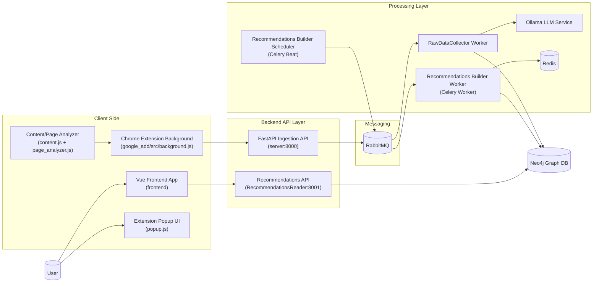
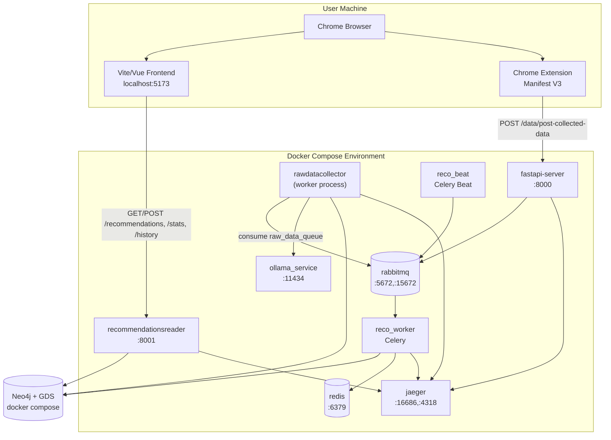
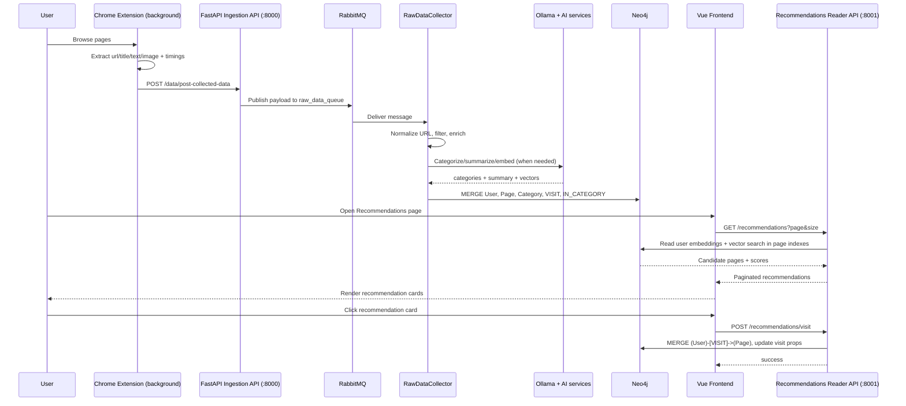
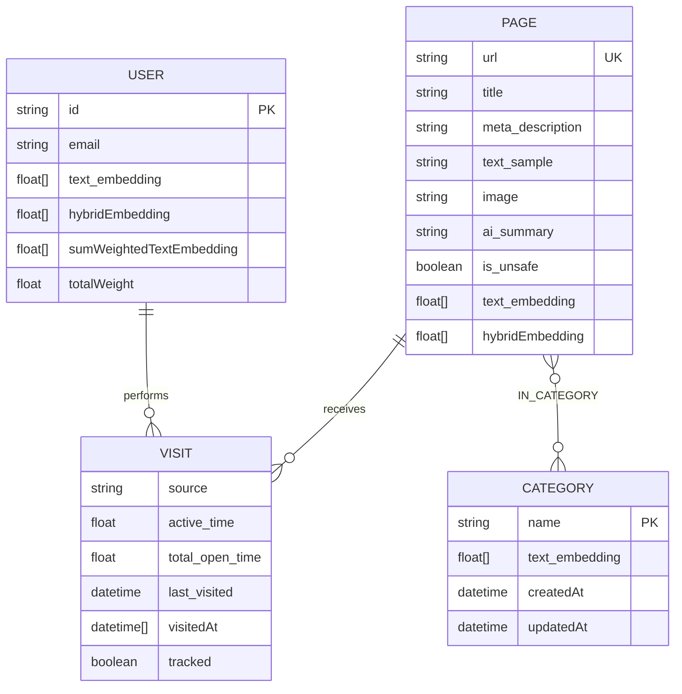

# Architecture Diagrams

This document contains project-specific diagrams based on the current codebase.

## 1) UML Component Diagram



## 2) UML Deployment Diagram



## 3) UML Sequence Diagram

Scenario: browser activity is collected, stored in graph, then user opens recommendations and sends feedback visit.



## 4) Graph Database Logical Scheme (Nodes and Relations)



Typical relationship directions in code:
- `(User)-[:VISIT]->(Page)`
- `(Page)-[:IN_CATEGORY]->(Category)`

## 5) Flowchart (Raw Data Processing Algorithm)

```mermaid
flowchart TD
    A["Receive message from raw_data_queue] --> B[Parse payload and extract user + entries"]
    B --> C{Any valid entries?}
    C -- No --> Z[Skip message]
    C -- Yes --> D[Ensure User node exists/updated]

    D --> E[For each entry: normalize URL]
    E --> F{Canonical URL exists?}
    F -- No --> N[Skip entry]
    F -- Yes --> G{Page exists in Neo4j?}

    G -- Yes --> H[Update Page metadata]
    G -- No --> I[Run filtration rules]
    I --> J{Should process?}
    J -- No --> N
    J -- Yes --> K[Categorize and summarize content]
    K --> L[Build embeddings for categories and page text]
    L --> M[Create Page + Category + IN_CATEGORY]

    H --> O[Prepare VISIT properties\n(active time, open time, timestamp)]
    M --> O
    O --> P{User id present?}
    P -- No --> Q[Finish entry]
    P -- Yes --> R[MERGE VISIT relation with additive metrics]
    R --> Q
    N --> Q
    Q --> S{More entries?}
    S -- Yes --> E
    S -- No --> T[Done]
```

## 6) Simple Interface Wireframes (2-3)

### Wireframe A: Home (unauthenticated)

```text
+--------------------------------------------------------------------------------+
| HEADER: Logo | Home | Recommendations | Statistics | Sign In                  |
+--------------------------------------------------------------------------------+
|                                                                            (bg)|
|                    [ AI-powered analytics badge ]                              |
|               Analyze your browser activity with Insights                       |
|      Smart assistant for personal recommendations and productivity stats        |
|                                                                                |
|   +---------------------------+    +---------------------------+               |
|   | Install Chrome Extension  |    | Secure SSO Login         |               |
|   | short help text           |    | short help text          |               |
|   +---------------------------+    +---------------------------+               |
|                                                                                |
|                     [ Sign in via Chrome Extension ]                            |
|                                                                                |
+--------------------------------------------------------------------------------+
```

### Wireframe B: Recommendations Page

```text
+--------------------------------------------------------------------------------+
| HEADER: Logo | Home | Recommendations* | Statistics | User                     |
+--------------------------------------------------------------------------------+
| Recommendations for you                                                        |
|--------------------------------------------------------------------------------|
| +-------------------+ +-------------------+ +-------------------+              |
| | image             | | image             | | image             |              |
| | page title        | | page title        | | page title        |              |
| | score + type      | | score + type      | | score + type      |              |
| | [Open]            | | [Open]            | | [Open]            |              |
| +-------------------+ +-------------------+ +-------------------+              |
| +-------------------+ +-------------------+ +-------------------+              |
| | ...               | | ...               | | ...               |              |
| +-------------------+ +-------------------+ +-------------------+              |
|                             [loading sentinel]                                  |
|                             [spinner / end text]                                |
+--------------------------------------------------------------------------------+
```

### Wireframe C: Statistics Dashboard

```text
+--------------------------------------------------------------------------------+
| HEADER: Logo | Home | Recommendations | Statistics* | User                     |
+--------------------------------------------------------------------------------+
| Your Analytics                                                                 |
|--------------------------------------------------------------------------------|
| +------------------+ +------------------+ +------------------+                 |
| | Total Visits     | | Unique Pages     | | Categories       |                 |
| | 1234             | | 321              | | 18               |                 |
| +------------------+ +------------------+ +------------------+                 |
|                                                                                |
| +----------------------------------+ +--------------------------------------+  |
| | Activity (7 days)                | | Interest Categories (donut)          |  |
| | [bar chart area]                 | | [donut chart area]                   |  |
| |                                  | |                                      |  |
| +----------------------------------+ +--------------------------------------+  |
+--------------------------------------------------------------------------------+
```
